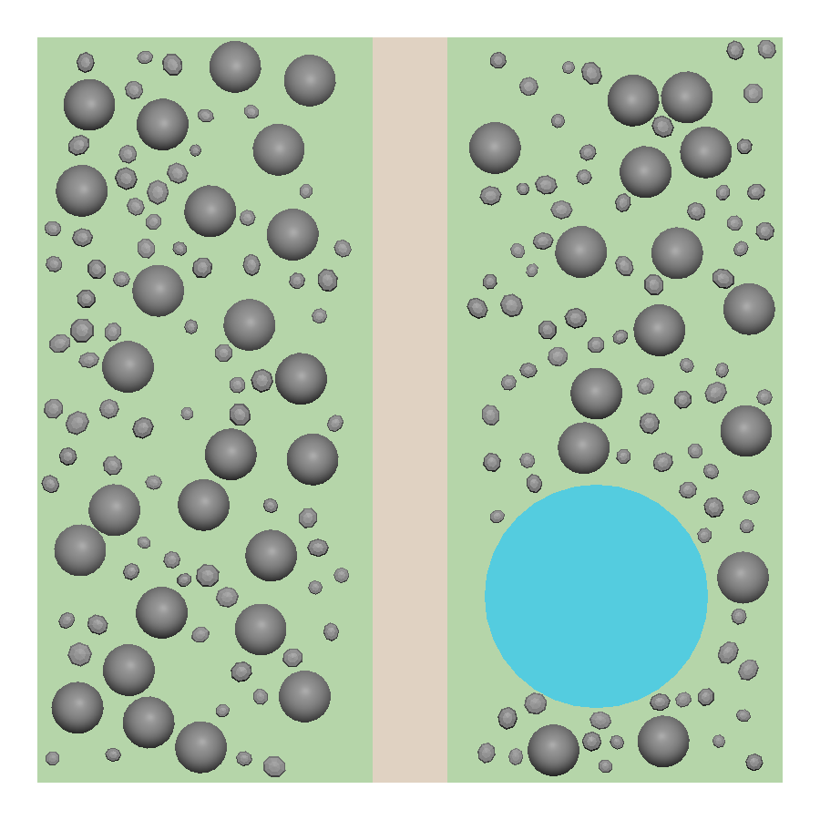

# Set Dresser

A small Maya tool that dresses a set for you. It scatters rocks and trees across a
40 × 40 ground plane and keeps them off a 4-wide path down the middle and out of a
round pond. You drive it from a window. You never need to open the code.



## Needs

- **Maya 2026** on Windows (tested in 2026.2). It uses Python 3 and `maya.cmds` only, with no plug-ins.

## Run it

1. Clone or download this repo. Note the folder it lands in.
2. In Maya, open **Windows → General Editors → Script Editor** and click a **Python** tab.
3. Paste these two lines. Change the path in the first line to **your** folder. Then press **Ctrl+Enter**:

```python
import sys; sys.path.insert(0, r"C:\path\to\set-dresser-agent")
import set_dresser_ui; set_dresser_ui.show()
```

The Set Dresser window opens.

## The window

| Control | What it does |
|---|---|
| **Rocks** | How many rocks to place (0–200). |
| **Trees** | How many trees to place (0–200). |
| **Area** | Size of the square they're scattered in, from the centre (10–40; 40 = the whole ground). |
| **Seed** | Picks the layout. The same seed with the same settings gives the same set every time, so "seed 12 was the one" can be rebuilt exactly. |
| **Keep path and pond clear** | When on, nothing lands on the path, within 1 unit of its edges, or in the pond. |
| **Scatter** | Builds a new set. It replaces the previous one. One **Ctrl+Z** undoes it. |
| **Clear** | Removes the rocks and trees. Nothing else in your scene is touched. |

If not everything fits (say, 200 trees in a small area), it places what it can and
says so in one line at the bottom of Maya.

## What it puts in your scene

- `layout`: the `ground`, `path` and `pond`. These are built once, and Clear leaves them alone.
- `rocks`: every `rock`.
- `trees`: every `tree`. Each tree is a `trunk` and a `canopy`.

## Files

- `set_dresser.py`: the engine. It makes things and holds the placement rules. It has no window code.
- `set_dresser_ui.py`: the window. It reads the controls and calls the engine.
- `send_to_maya.py`: a helper for sending code to a running Maya over its command port (port 7001). You don't need it to use the tool.

## Peer Run
Fiori: The tool ran without isssue and the buttons worked as intended 
